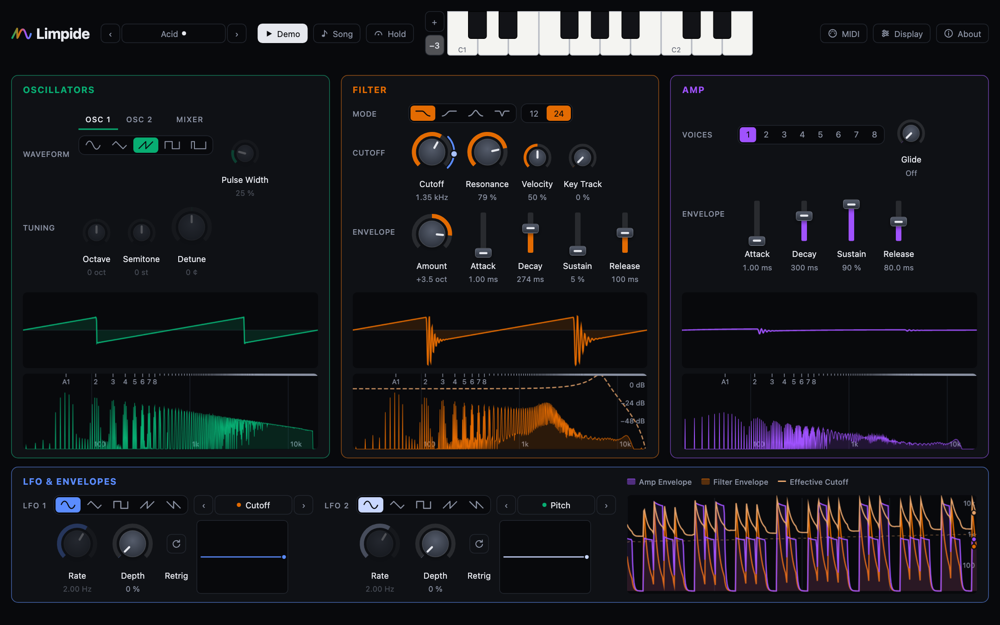

# Limpide

**A subtractive synthesizer that shows you what each stage does to the sound.**

▶ **[Play it in your browser](https://gijom33.github.io/limpide/)**. Nothing to install.

[](https://gijom33.github.io/limpide/)

Every picture on the page moves with the sound you hear.

Ordinary synths give you a sound and a row of knobs, and the cause and effect stays hidden in the signal. Limpide is laid out as its own signal-flow diagram: Oscillators → Mixer → Filter → Amp, left to right, with live Viewers under every stage. Turn the Cutoff and you can see which Harmonics the Filter takes away.

## What you can do

- **Learn by building.** Tutorials rebuild a Preset from Init one control at a time: you turn each knob, then hear and see what it changed. Seven so far: Bass, Acid, Pluck and Wobble, then FM Ladder, Ring Bell and Deep Breath for FM, Ring, the Sub and the Noise’s colour.
- **See the subtraction.** Each stage has a cycle-locked Scope and a Spectrum. The Filter's real Response Curve is drawn over the Spectrum.
- **Check Harmonics against theory.** Markers name each Harmonic, and an Ideal Reference shows what theory predicts for the Waveform.
- **Watch modulation over time.** The Envelope Timeline draws both Envelopes, the LFO and the Effective Cutoff as they move.
- **Study a moment.** Freeze, A/B Snapshots, axis toggles and a hover readout. Hold keeps a note sounding while you turn knobs.
- **Play however you like.** Use the computer keyboard (`A W S E D F T G…`, with `Z`/`X` to change octave), the on-screen piano, or any MIDI controller via MIDI Learn. Patches can have one to eight Voices.
- **Keep and share sounds.** Presets to start from, autosave, a named Patch library, JSON export, and share links that carry the whole Patch in the URL.

Works best in **Chrome or Edge**. Safari has no Web MIDI, so MIDI controllers don't work there; everything else does. The same goes for every browser on iPhone and iPad, Chrome included, since Apple makes them all run on Safari's engine.

Visits to the site are counted with [GoatCounter](https://www.goatcounter.com): no cookies, and no personal data stored. Like any web page, it receives each visitor's IP address and browser to count them; the share link's sound (after `#`) is never sent. Only the published site counts: a fork's build doesn't, unless its deploy sets `GOATCOUNTER_URL`.

## Run it locally

You need [Node.js](https://nodejs.org) 22.12 or newer.

```bash
git clone https://github.com/gijom33/limpide.git
cd limpide
npm install
npm run dev
```

Then open the address it prints (usually http://localhost:5173).

| Command | What it does |
| --- | --- |
| `npm run dev` | Start the app with live reload |
| `npm run build` | Type-check and build the static site into `dist/` |
| `npm run test:unit` | Fast unit tests (Node) |
| `npm run test:engine` | Audio engine tests in headless Chromium |
| `npm run test:e2e` | End-to-end tests with Playwright |
| `npm run stats` | Measure the project for [the statistics page](docs/statistics.md), before a release |

The browser tests need Playwright's browsers once: `npx playwright install chromium webkit`.

## How it's built

TypeScript, React and Vite, on the browser's native Web Audio nodes; no audio libraries.

- [CONTEXT.md](CONTEXT.md): the project's vocabulary (Patch, Voice, Tap, Effective Cutoff…). Code and docs use these words exactly.
- [docs/adr](docs/adr): architecture decisions and why they were made.
- [docs/issues](docs/issues): the vertical slices the app was built in, in order.
- [docs/statistics.md](docs/statistics.md): the project's size, quality and performance, release by release (`npm run stats`).

<!-- statistics -->
At 1.16.0 (2026-10-30): 13,047 lines of app code, 912 tests written, 214.5 kB of JavaScript gzipped. Every number, release by release, is on [the statistics page](docs/statistics.md).
<!-- /statistics -->

## How this was built

Limpide was designed and directed by Guillaume Boillet, and its code written with [Claude Code](https://claude.com/claude-code), Anthropic's AI coding agent (every commit says so in its `Co-Authored-By` line). The work follows Matt Pocock's [AI Hero](https://www.aihero.dev) method, and everything it produced is in this repository:

1. **A PRD** ([docs/prd.md](docs/prd.md)): who it is for, the user stories, what is out of scope, how it is tested.
2. **Issues** ([docs/issues](docs/issues)): vertical slices, each with what to build, its checklist and what was measured. Plans are "grilled" (questioned until the decisions are explicit) before they are built.
3. **Decisions** ([docs/adr](docs/adr)) and a **glossary** ([CONTEXT.md](CONTEXT.md)), kept true to the code.
4. **Tests first** where behaviour can be measured: the engine renders real audio and checks Harmonics against theory; Playwright plays the built site in two browsers.
5. **An inbox** ([docs/inbox.md](docs/inbox.md)): bugs and ideas as they come, triaged into issues.
6. **Reviews** ([docs/reviews](docs/reviews)): agents playing a dozen kinds of visitor (a curious contact, a synth player, a designer, a teacher, a screen-reader user, a sceptic of AI code…), their findings back in the inbox.
7. **The agent's working rules** ([CLAUDE.md](CLAUDE.md)): how commits, decisions and releases are recorded ([ADR-0010](docs/adr/0010-how-the-work-is-recorded.md)).

The owner decides what Limpide is, what it looks like, and what ships; those decisions are dated in the issues. The agent proposes, writes the code, the tests and the docs, and checks its work in a real browser before it is committed.

Every push to `main` is tested and deployed to GitHub Pages by [a workflow](.github/workflows/deploy.yml).

## License

[MIT](LICENSE) © Guillaume Boillet: the code, the Presets, the Demo's music and the docs. The site also ships React (MIT); the build writes its notices to `third-party-notices.txt`, linked from About.
