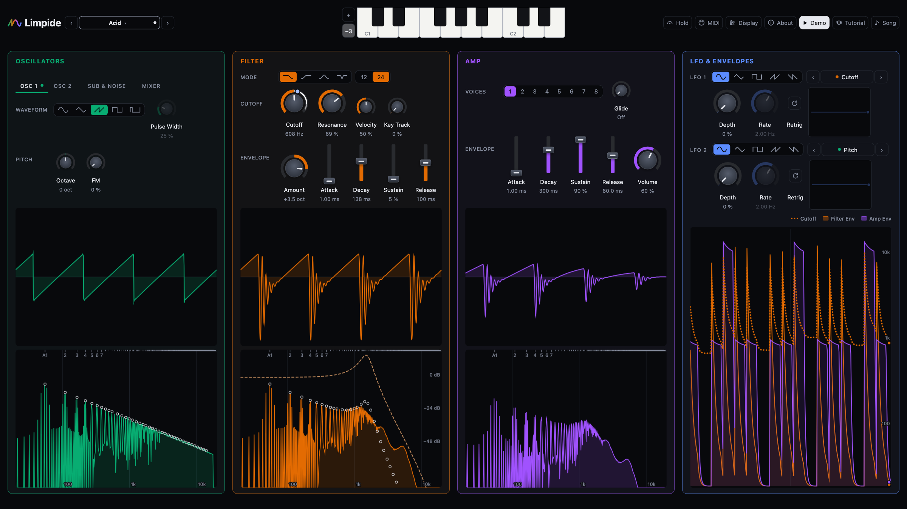

# Limpide

**A synthesizer you can see through: the wave and its Harmonics after every stage, as you play.**

Designed and directed by [Guillaume Boillet](https://www.linkedin.com/in/guillaume-boillet-18208310); code written with [Claude Code](https://claude.com/claude-code), Anthropic's AI coding agent.

▶ **[Play it in your browser](https://gijom33.github.io/limpide/)**. Nothing to install.

Enjoying it? Share it, or [⭐ the repository](https://github.com/gijom33/limpide).

[](https://gijom33.github.io/limpide/)

*Limpide* is French for clear, see-through. Under each stage of the sound, the Oscillators, the Filter and the Amp, a Scope draws the wave in time and a Spectrum its Harmonics in frequency, both live as you play. Turn the Cutoff and you see which Harmonics the Filter takes away, and the wave's corners round off with them.

The sounds themselves are not new: Limpide is a classic subtractive synth, laid out as its own signal-flow diagram, Oscillators → Mixer → Filter → Amp, left to right. Ordinary synths give you a sound and a row of knobs, and the cause and effect stays hidden in the signal; here every picture moves with the sound you hear.

## What you can do

- **Take the Tour.** A first look for anyone who has never seen a synth: a card for each Section in the signal’s order, while the synth turns its controls itself and plays. Your own Patch comes back when it ends.
- **Learn by building.** Tutorials rebuild a Preset from Init one Step at a time: you turn each knob, or a set of faders together, then hear and see what it changed. Nine so far: Sub Ladder, each wave’s Harmonics side by side, then Bass, Acid, Pluck and Wobble, PWM Bass for pulse width modulation, then FM Ladder, Ring Bell and Deep Breath for FM, Ring, the Sub and the Noise’s colour.
- **See the subtraction.** Each stage has a cycle-locked Scope and a Spectrum. The Filter's real Response Curve is drawn over the Spectrum.
- **Check Harmonics against theory.** Markers name each Harmonic, and an Ideal Reference shows what theory predicts for the Waveform.
- **Watch modulation over time.** The Envelope Timeline draws both Envelopes, the Effective Cutoff and what the two LFOs and a keyboard's aftertouch move, as they move.
- **Study a moment.** Freeze, A/B Snapshots, axis toggles and a hover readout. Hold keeps a note sounding while you turn knobs.
- **Play however you like.** Use the computer keyboard (`A W S E D F T G…`, with `Z`/`X` to change octave), the on-screen piano, or any MIDI controller via MIDI Learn. Patches can have one to eight Voices.
- **Play in time.** A tempo in the header, set by hand, by Tap Tempo or by a MIDI clock; an LFO's Rate can Sync to it as a note value (1/4, 1/16, triplets…), so a wobble keeps to the beat. Legato for one-Voice lines, and a keyboard's aftertouch moves the Destination you pick.
- **Keep and share sounds.** Presets to start from, the classic subtractive sounds chosen to teach, each saying what to watch; autosave, a named Patch library, JSON export, and share links that carry the whole Patch in the URL.
- **Meet Bead.** A little water drop called Bead lives on the page and answers what you play. Switch it off in Display to keep it away, or play `B, E, A, D` to send it away for the visit.

Works best in **Chrome or Edge**. Safari has no Web MIDI, so MIDI controllers don't work there; everything else does. The same goes for every browser on iPhone and iPad, Chrome included, since Apple makes them all run on Safari's engine.

Visits to the site are counted with [GoatCounter](https://www.goatcounter.com): no cookies, and no personal data stored. Like any web page, the site's host (GitHub Pages) and the counter receive each visitor's IP address and browser; the share link's sound (after `#`) is never sent. Only the published site counts: a fork's build doesn't, unless its deploy sets `GOATCOUNTER_URL`.

## Run it locally

You need [Node.js](https://nodejs.org) 22.12 or newer.

```bash
git clone https://github.com/gijom33/limpide.git
cd limpide
npm install
npm run dev
```

Then open the address it prints (usually http://localhost:5173).

| Command | What it does |
| --- | --- |
| `npm run dev` | Start the app with live reload |
| `npm run build` | Type-check and build the static site into `dist/` |
| `npm run test:unit` | Fast unit tests (Node) |
| `npm run test:engine` | Audio engine tests in headless Chromium |
| `npm run test:e2e` | End-to-end tests with Playwright |
| `npm run stats` | Measure the project for [the statistics page](docs/statistics.md), after a release |
| `npm run perf` | Measure what a frame costs, idle, in the Demo and in a chord, before and after a change |

The browser tests need Playwright's browsers once: `npx playwright install chromium webkit`.

## How this was built

TypeScript, React and Vite, on the browser's native Web Audio nodes; no audio libraries.

Every commit names Claude Code in its `Co-Authored-By` line, but for eight merges of one branch into another, from 2026-10-30 to 2026-11-01. The work follows Matt Pocock's [AI Hero](https://www.aihero.dev) method, and everything it produced is in this repository:

1. **A PRD** ([docs/prd.md](docs/prd.md)): who it is for, the user stories, what is out of scope, how it is tested.
2. **Issues** ([docs/issues](docs/issues)): the vertical slices the app was built in, in order, each with what to build, its checklist and what was measured. Plans are "grilled" (questioned until the decisions are explicit) before they are built.
3. **Decisions** ([docs/adr](docs/adr)): the architecture decisions and why they were made. And a **glossary** ([CONTEXT.md](CONTEXT.md)): the project's vocabulary (Patch, Voice, Tap, Effective Cutoff…), which the code and docs use exactly. Both are kept true to the code.
4. **Tests first** where behaviour can be measured: the engine renders real audio and checks Harmonics against theory; Playwright plays the built site in two browsers.
5. **An inbox** ([docs/inbox.md](docs/inbox.md)): bugs and ideas as they come, triaged into issues.
6. **Reviews** ([docs/reviews](docs/reviews)): twenty agent reviewers, seventeen of them playing a kind of visitor (a curious contact, a synth player, a designer, a teacher, a screen-reader user, a sceptic of AI code…) and three checking the words and the sound against the code, their findings back in the inbox.
7. **The agent's working rules** ([CLAUDE.md](CLAUDE.md)): how commits, decisions and releases are recorded ([ADR-0010](docs/adr/0010-how-the-work-is-recorded.md)), and [the release steps](docs/releasing.md).

The owner decides what Limpide is, what it looks like, and what ships; those decisions are dated in the issues. The agent proposes, writes the code, the tests and the docs, and checks its work in a real browser before it is committed.

Every push to `main` is tested and deployed to GitHub Pages by [a workflow](.github/workflows/deploy.yml). The project's size, quality and performance are measured at each release (`npm run stats`):

<!-- statistics -->
At 1.26.2 (2026-11-07): 26,624 lines of app code, 3,595 tests, all passing, 73.9% of the app code’s lines run by the unit and engine tests, 292.3 kB of JavaScript gzipped, the page drawn in 304 ms, the Demo at 56 frames a second. Every number, release by release, is on [the statistics page](docs/statistics.md).
<!-- /statistics -->

## License

[MIT](LICENSE) © Guillaume Boillet: the code, the Presets, the Demo's music and the docs; the quotations in the docs stay their authors', under their own terms. The site also ships React (MIT); the build writes its notices, then Limpide's own licence, to `third-party-notices.txt`, linked from About.

Product names (synthesizers, controllers, browsers) are their owners' trademarks; Limpide is not affiliated with or endorsed by them.
